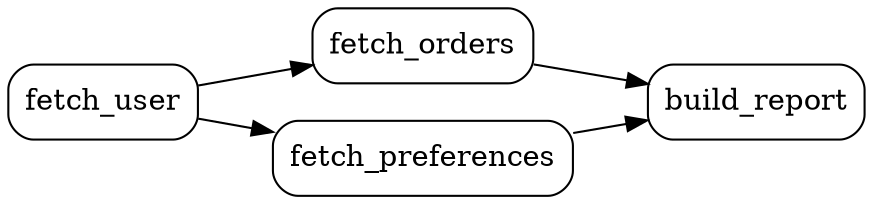

# DependencyGraphVisualizer API Reference

`DependencyGraphVisualizer` renders a pipeline's dependency graph as ASCII art, Graphviz DOT, Mermaid, a text execution plan, or an interactive HTML page.

## Class: `SimpleFlow::DependencyGraphVisualizer`

**Location**: [`lib/simple_flow/dependency_graph_visualizer.rb`](https://github.com/MadBomber/simple_flow/blob/main/lib/simple_flow/dependency_graph_visualizer.rb)

### Getting a Visualizer

Most code gets one from a pipeline with named steps:

```ruby
pass = ->(result) { result.continue(result.value) }

pipeline = SimpleFlow::Pipeline.new do
  step :fetch_user, pass, depends_on: :none
  step :fetch_orders, pass, depends_on: [:fetch_user]
  step :fetch_preferences, pass, depends_on: [:fetch_user]
  step :build_report, pass, depends_on: [:fetch_orders, :fetch_preferences]
end

visualizer = pipeline.visualize # => DependencyGraphVisualizer, or nil if the pipeline has no named steps
```

The examples on this page use this pipeline.

### Constructor

#### `new(graph)`

Builds a visualizer for a `SimpleFlow::DependencyGraph` directly, without a pipeline.

**Parameters:**
- `graph` (DependencyGraph) - The graph to render

**Example:**
```ruby
graph = SimpleFlow::DependencyGraph.new(
  fetch_user: [],
  fetch_orders: [:fetch_user]
)
visualizer = SimpleFlow::DependencyGraphVisualizer.new(graph)
```

### Attributes

#### `graph`

The `DependencyGraph` passed to the constructor.

### Output Methods

#### `to_ascii(show_groups: true)`

Returns a text diagram for the terminal: each step's dependencies, the sequential execution order and, when `show_groups` is true, the parallel execution groups and an execution tree.

**Parameters:**
- `show_groups` (Boolean) - Include the parallel groups and execution tree (default: true)

**Returns:** String

**Pipeline shortcut:** `pipeline.visualize_ascii(show_groups: true)`

**Sample output** (the tail of `puts visualizer.to_ascii`):
```
Parallel Execution Groups:
  Group 1:
    └─ :fetch_user (sequential)
  Group 2:
    ├─ Parallel execution of 2 steps:
    ├─ :fetch_orders
    └─ :fetch_preferences
  Group 3:
    └─ :build_report (sequential)

Execution Tree:
  ├─ :fetch_user
  ├─ [Parallel]
  │  ├─ :fetch_orders
  │  └─ :fetch_preferences
  └─ :build_report
```

#### `to_dot(include_groups: true, orientation: 'TB')`

Returns a Graphviz DOT document. With `include_groups`, each parallel group gets its own fill color and a legend. Step names that are not plain DOT identifiers (such as `:"fetch-user"`) are quoted.

**Parameters:**
- `include_groups` (Boolean) - Color-code parallel groups and add a legend (default: true)
- `orientation` (String) - `'TB'` (top to bottom) or `'LR'` (left to right) (default: `'TB'`)

**Returns:** String

**Pipeline shortcut:** `pipeline.visualize_dot(include_groups: true, orientation: 'TB')`

**Example:**
```ruby
File.write('pipeline.dot', visualizer.to_dot)
# dot -Tpng pipeline.dot -o pipeline.png
```

**Sample output** (`to_dot(include_groups: false, orientation: 'LR')`):


#### `to_mermaid`

Returns a Mermaid `graph TD` diagram. Parallel groups with more than one step get a fill color.

**Returns:** String

**Pipeline shortcut:** `pipeline.visualize_mermaid`

**Sample output:**
```
graph TD
  fetch_user[fetch_user]
  fetch_user[fetch_user] --> fetch_orders[fetch_orders]
  fetch_user[fetch_user] --> fetch_preferences[fetch_preferences]
  fetch_orders[fetch_orders] --> build_report[build_report]
  fetch_preferences[fetch_preferences] --> build_report[build_report]
  classDef group1 fill:#9f9
  class fetch_orders group1
  class fetch_preferences group1
```

Paste it into [mermaid.live](https://mermaid.live/) or a Markdown file that renders Mermaid.

#### `to_execution_plan`

Returns a text plan: the number of steps and phases, what runs in each phase, and a speedup estimate that counts each step as one time unit.

**Returns:** String

**Pipeline shortcut:** `pipeline.execution_plan`

**Sample output:**
```
Execution Plan
============================================================

Total Steps: 4
Execution Phases: 3

Phase 1:
  → Execute :fetch_user

Phase 2:
  ⚡ Execute in parallel:
     • :fetch_orders (after :fetch_user)
     • :fetch_preferences (after :fetch_user)

Phase 3:
  → Execute :build_report

Performance Estimate:
  Sequential execution: 4 time units
  Parallel execution: 3 time units
  Potential speedup: 1.33x
```

#### `to_html(title: "Dependency Graph")`

Returns a standalone HTML page that draws the graph interactively with [vis-network](https://visjs.github.io/vis-network/), colored by parallel group, with a legend listing each group. The page loads vis-network from unpkg.com, so viewing it needs network access.

**Parameters:**
- `title` (String) - Page title and heading (default: `"Dependency Graph"`)

**Returns:** String

There is no `Pipeline#visualize_*` shortcut for this one; call it on the visualizer:

```ruby
File.write('pipeline.html', pipeline.visualize.to_html(title: 'Report Pipeline'))
```

### Pipeline Shortcuts

| Visualizer method | Pipeline method |
|---|---|
| `to_ascii(show_groups:)` | `visualize_ascii(show_groups:)` |
| `to_dot(include_groups:, orientation:)` | `visualize_dot(include_groups:, orientation:)` |
| `to_mermaid` | `visualize_mermaid` |
| `to_execution_plan` | `execution_plan` |
| `to_html(title:)` | none; use `pipeline.visualize.to_html` |

Each pipeline method returns `nil` when the pipeline has no named steps.

!!! note
    Optional steps (`depends_on: :optional`) are drawn as steps with no dependencies, so every view shows them in the first phase whether or not they will be activated.

## Related Documentation

- [Pipeline API](pipeline.md) - Visualization methods on `Pipeline`
- [Parallel Steps Guide](../concurrent/parallel-steps.md) - Named steps and dependencies
- [Examples](../getting-started/examples.md) - `examples/08_graph_visualization.rb` and `examples/09_pipeline_visualization.rb`
